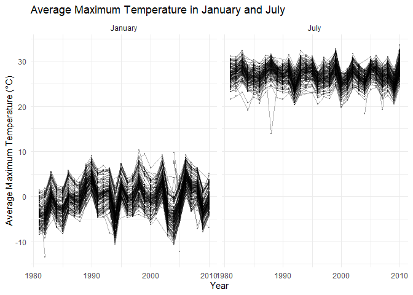
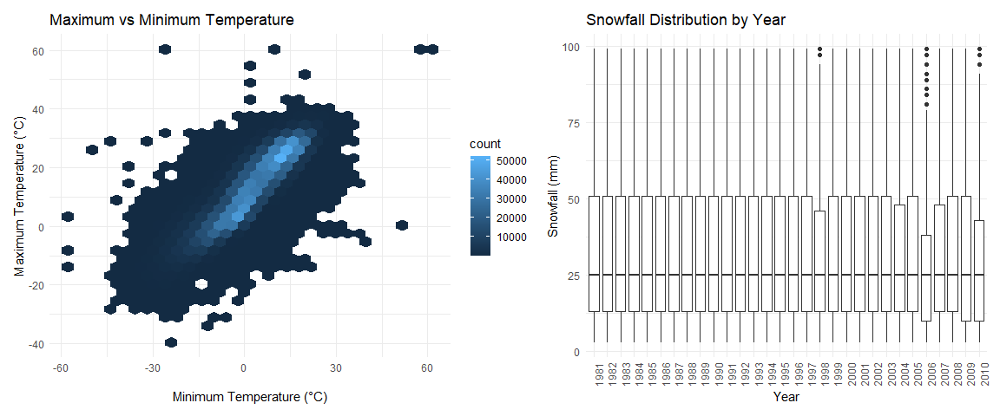

P8105 Homework 3
================
By Wenda Yoanda, UNI:wy2486

## Problem 1: NY NOAA Data

### Explore the dataset

``` r
skimr::skim(ny_noaa)
```

|                                                  |         |
|:-------------------------------------------------|:--------|
| Name                                             | ny_noaa |
| Number of rows                                   | 2595176 |
| Number of columns                                | 7       |
| \_\_\_\_\_\_\_\_\_\_\_\_\_\_\_\_\_\_\_\_\_\_\_   |         |
| Column type frequency:                           |         |
| character                                        | 3       |
| Date                                             | 1       |
| numeric                                          | 3       |
| \_\_\_\_\_\_\_\_\_\_\_\_\_\_\_\_\_\_\_\_\_\_\_\_ |         |
| Group variables                                  | None    |

Data summary

**Variable type: character**

| skim_variable | n_missing | complete_rate | min | max | empty | n_unique | whitespace |
|:--------------|----------:|--------------:|----:|----:|------:|---------:|-----------:|
| id            |         0 |          1.00 |  11 |  11 |     0 |      747 |          0 |
| tmax          |   1134358 |          0.56 |   1 |   4 |     0 |      532 |          0 |
| tmin          |   1134420 |          0.56 |   1 |   4 |     0 |      548 |          0 |

**Variable type: Date**

| skim_variable | n_missing | complete_rate | min | max | median | n_unique |
|:---|---:|---:|:---|:---|:---|---:|
| date | 0 | 1 | 1981-01-01 | 2010-12-31 | 1997-01-21 | 10957 |

**Variable type: numeric**

| skim_variable | n_missing | complete_rate |  mean |     sd |  p0 | p25 | p50 | p75 |  p100 | hist  |
|:--------------|----------:|--------------:|------:|-------:|----:|----:|----:|----:|------:|:------|
| prcp          |    145838 |          0.94 | 29.82 |  78.18 |   0 |   0 |   0 |  23 | 22860 | ▇▁▁▁▁ |
| snow          |    381221 |          0.85 |  4.99 |  27.22 | -13 |   0 |   0 |   0 | 10160 | ▇▁▁▁▁ |
| snwd          |    591786 |          0.77 | 37.31 | 113.54 |   0 |   0 |   0 |   0 |  9195 | ▇▁▁▁▁ |

The `ny_noaa` dataset contains **2,595,176 observations** and **7
variables**. The dataset is structured as a tibble with **3 character
variables, 3 numeric variables, and 1 date variable**.

The variables include:

- `id`: Weather station ID
- `date`: Date of observation
- `prcp`: Precipitation (tenths of mm)
- `snow`: Snowfall (mm)
- `snwd`: Snow depth (mm)
- `tmax`: Maximum temperature (tenths of degrees C)
- `tmin`: Minimum temperature (tenths of degrees C)

**Missing data** are a substantial issue, particularly for temperature
measurements. Approximately **43.71%** of observations are missing for
both `tmax` and `tmin`. Snowfall (`snow`) also has **381,221 missing
observations**, which could affect the analysis of weather patterns.

### Clean the dataset

I created separate variables for year, month, and day from the date
variable. Temperature (tmax and tmin) and precipitation (prcp) were
recorded in tenths of their respective units, so I divided them by 10 to
convert them into degrees Celsius and millimeters. Snowfall (snow) was
already recorded in millimeters, so no conversion was needed.

``` r
ny_noaa_df = ny_noaa |>
  janitor::clean_names()

ny_noaa_clean = ny_noaa_df |>
  separate(
    date,
    into = c("year", "month", "day"),
    sep = "-",
    convert = TRUE,
    remove = FALSE
  ) |>
  mutate(
    tmax = as.numeric(tmax) / 10,
    tmin = as.numeric(tmin) / 10,
    prcp = prcp / 10
  )
```

### Most Commonly Observed Snowfall Values

I excluded missing snowfall observations using `drop_na(snow)` to
identify the 10 most commonly recorded snowfall values.

``` r
ny_noaa_clean |>
  drop_na(snow) |>
  count(snow, sort = TRUE) |>
  head(10)
```

    ## # A tibble: 10 × 2
    ##     snow       n
    ##    <int>   <int>
    ##  1     0 2008508
    ##  2    25   31022
    ##  3    13   23095
    ##  4    51   18274
    ##  5    76   10173
    ##  6     8    9962
    ##  7     5    9748
    ##  8    38    9197
    ##  9     3    8790
    ## 10   102    6552

**Observations and Interpretations:**

After removing missing values (NA), the most common snowfall value is
**0 mm (2,008,508 observations)**, which makes sense because it does not
snow every day. Among nonzero snowfall values, 25 mm, 13 mm, and 51 mm
are the most common, possibly because snowfall measurements are rounded
or converted from inches to millimeters.

### Average Maximum Temperature in January and July

I calculated the average maximum temperature (`tmax`) for January and
July at each weather station across years using `group_by()` and
`summarize()`. I then created a two-panel plot to compare temperature
patterns between the two months.

``` r
ny_noaa_clean |>
  filter(month %in% c(1, 7)) |>
  drop_na(tmax) |>
  group_by(id, year, month) |>
  summarize(
    mean_tmax = mean(tmax),
    .groups = "drop"
  ) |>
  mutate(
    month = factor(
      month,
      levels = c(1, 7),
      labels = c("January", "July")
    )
  ) |>
  ggplot(aes(x = year, y = mean_tmax, group = id)) +
  geom_line(alpha = 0.3) +
  geom_point(alpha = 0.3, size = 0.5) +
  facet_grid(. ~ month) +
  labs(
    title = "Average Maximum Temperature in January and July",
    x = "Year",
    y = "Average Maximum Temperature (°C)"
  ) +
  theme_minimal()
```

<!-- --> The
average maximum temperature in January is consistently lower than in
July across weather stations. January temperatures generally range from
−10°C to 10°C, while July temperatures are mostly concentrated between
20°C and 32°C. There is some variation across stations, although their
temperature patterns generally follow similar year-to-year fluctuations.
No clear overall increasing or decreasing trend is observed. Potential
outliers include an unusually low January temperature around 1983
(approximately −13°C) and an unusually low July temperature around 1987
(approximately 14°C).

### Temperature Relationship and Snowfall Distribution

The first panel examines the relationship between maximum (`tmax`) and
minimum (`tmin`) temperatures. I used `geom_hex()` instead of a
scatterplot to reduce overplotting due to the large number of
observations.

The second panel shows the distribution of snowfall measurements greater
than `0` mm and less than `100` mm separately for each year using
boxplots.

``` r
library(patchwork)

ggp_temp = ny_noaa_clean |>
  drop_na(tmax, tmin) |>
  ggplot(aes(x = tmin, y = tmax)) +
  geom_hex() +
  labs(
    title = "Maximum vs Minimum Temperature",
    x = "Minimum Temperature (°C)",
    y = "Maximum Temperature (°C)"
  ) +
  theme_minimal()

ggp_snow = ny_noaa_clean |>
  filter(snow > 0, snow < 100) |>
  ggplot(aes(x = factor(year), y = snow)) +
  geom_boxplot() +
  labs(
    title = "Snowfall Distribution by Year",
    x = "Year",
    y = "Snowfall (mm)"
  ) +
  theme_minimal() +
  theme(
    axis.text.x = element_text(angle = 90, hjust = 1)
  )

ggp_temp + ggp_snow
```

<!-- -->

**Observations and Interpretations:**

1.  **Maximum vs. Minimum Temperature:** There is a strong positive
    relationship between minimum and maximum temperatures. As minimum
    temperature increases, maximum temperature generally increases as
    well. Most observations are concentrated around minimum temperatures
    of 0–25°C and maximum temperatures of 5–30°C, with a few extreme
    observations outside these ranges.

2.  **Snowfall Distribution by Year:** Snowfall distributions appear
    relatively similar across most years, with median snowfall values
    around 25 mm and upper quartiles around 50 mm. However, some years
    show greater variability, particularly in the later years. Several
    high snowfall observations close to 100 mm are also observed.

Overall, the first plot shows a clear positive relationship between
minimum and maximum temperature, while the second plot suggests that
snowfall distributions remain relatively consistent across years, with
some differences in variability and extreme values.
